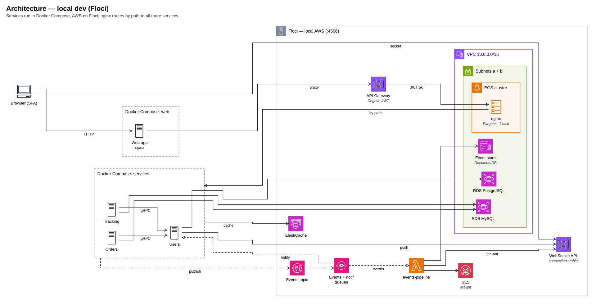

# 3 Microservices Running on AWS Infrastructure (3MRAI)

Three microservices, an event pipeline and a web storefront, all provisioned with
Terraform against AWS — and reproduced end to end on a laptop with
[Floci](docs/shared/decisions/ADR-0017-floci-local.md), a local AWS emulator.

The project knowledge lives in the Obsidian vault at [`docs/`](docs/). Start at the root
map of content: [`docs/00-overview/index.md`](docs/00-overview/index.md).



## What runs

| Component | Path | Stack | Design |
|---|---|---|---|
| Users | [`services/users/`](services/users/) | NestJS 12 on Fastify, Prisma, PostgreSQL | [users-service-design](docs/domains/users/specs/users-service-design.md) |
| Orders | [`services/orders/`](services/orders/) | .NET 10 Minimal APIs, EF Core, MySQL | [orders-service-design](docs/domains/orders/specs/orders-service-design.md) |
| Tracking | [`services/tracking-go/`](services/tracking-go/) | Go, Gin, sqlc, golang-migrate, MySQL | [tracking-service-design](docs/domains/tracking/specs/tracking-service-design.md) |
| Events pipeline | [`functions/events-pipeline/`](functions/events-pipeline/) | SNS → SQS → Lambda (Node.js), DocumentDB, SES | [events-pipeline-design](docs/domains/events-pipeline/specs/events-pipeline-design.md) |
| Realtime events | [`functions/realtime-events/`](functions/realtime-events/) | WebSocket API Gateway + Lambda, DynamoDB | [realtime tracking events](docs/superpowers/specs/2026-08-05-realtime-tracking-events-websocket-design.md) |
| Web app | [`apps/web/`](apps/web/) | Angular 22, NgRx, Tailwind | [web app foundation](docs/superpowers/specs/2026-08-17-web-app-foundation-design.md) |
| Infrastructure | [`infra/`](infra/) | Terraform, cloudposse naming | [terraform-modules](docs/infrastructure/specs/terraform-modules.md) |
| Tests | [`e2e/`](e2e/) | Playwright (internal + gateway), Gatling JS load tests | [testing](docs/shared/conventions/testing.md) |
| Diagrams | [`diagrams/`](diagrams/) | diagram-design HTML sources, rendered to PNG | [diagrams](docs/shared/conventions/diagrams.md) |

Traffic enters through API Gateway with Cognito JWTs, reaches the services behind an ALB
(an nginx ECS task locally), and services talk to each other over gRPC and HTTP. Domain
events fan out through SNS/SQS into the events pipeline. Full picture:
[architecture](docs/00-overview/architecture.md) and
[system-context](docs/00-overview/system-context.md).

Integrations: **Stripe** payments
([design](docs/superpowers/specs/2026-09-19-stripe-payments-design.md),
[sandbox setup](docs/infrastructure/runbooks/stripe-sandbox-setup.md)) and **Geoapify**
address geocoding
([design](docs/superpowers/specs/2026-09-06-address-geocoding-proxy-design.md)).

## Environments

| Environment | Entry point | Runbook |
|---|---|---|
| Local dev — services in Docker Compose, AWS on Floci | `make bootstrap` | [local-dev-floci](docs/infrastructure/runbooks/local-dev-floci.md) |
| Pre-prod — every service as an ECS task on its own Floci | `make preprod-up` | [preprod](docs/infrastructure/runbooks/preprod.md) |

The two never run side by side: they share port 4566 and the ECR registry
([environment-exclusivity](docs/shared/conventions/environment-exclusivity.md),
[ADR-0022](docs/shared/decisions/ADR-0022-preprod-ecs-on-floci.md)).

## Local development

This repo pins Node via [`.nvmrc`](.nvmrc) — run `nvm use` first. **pnpm** is the package
manager, never npm or yarn ([package-manager](docs/shared/conventions/package-manager.md)).

```bash
nvm use
make bootstrap   # Floci + Terraform + env files + migrations + services, from scratch
make doctor      # what ran, what did not, and how to finish it
make heal        # recover after a Floci/Docker restart
make help        # every target
```

| URL | What |
|---|---|
| `http://localhost:3004` | Web app |
| `http://localhost:3000` / `3001` / `3002` | Users / Orders / Tracking, direct |
| `http://localhost:4566` | Floci (AWS emulator) |
| `http://localhost:8025` | Mailpit (outgoing email) |
| `http://localhost:5080` | OpenObserve — logs and traces (`make observability-up`) |

Env files are generated from Terraform outputs by `make env-file` — never hand-edited
([env-files](docs/shared/conventions/env-files.md)). Each service ships a `.http` file
(e.g. `services/users/users.http`) for the VS Code REST Client. Full convention:
[local-dev](docs/shared/conventions/local-dev.md).

## Testing

Every endpoint carries three layers: unit/integration, internal E2E against the service
URL, and gateway E2E with a real Cognito JWT
([testing](docs/shared/conventions/testing.md)).

```bash
make test-unit    # layer 1
make test-e2e     # layers 2 + 3 — needs `make bootstrap` up
make load-test    # Gatling fullJourney simulation
```

## Observability

Logs and traces from the services and the browser go through an OpenTelemetry collector
into OpenObserve ([ADR-0018](docs/shared/decisions/ADR-0018-observability-openobserve.md),
[ADR-0019](docs/shared/decisions/ADR-0019-distributed-tracing-opentelemetry.md)). Every log
line carries a shared cross-service context
([logging-context](docs/shared/conventions/logging-context.md)); browser telemetry follows
[browser-rum](docs/shared/conventions/browser-rum.md). Runbook:
[openobserve-runbook](docs/shared/observability/openobserve-runbook.md).

## The vault

The vault uses a hybrid **domain + type** layout. Cross-cutting rules are defined once in
`shared/` and referenced from service specs by `[[wikilink]]` — never duplicated.

- [`docs/00-overview/`](docs/00-overview/) — root MOC, [architecture](docs/00-overview/architecture.md), [system-context](docs/00-overview/system-context.md), [glossary](docs/00-overview/glossary.md)
- [`docs/domains/`](docs/domains/) — one folder per service (`specs/`, `decisions/`, `runbooks/`, `testing/`)
- [`docs/infrastructure/`](docs/infrastructure/) — Terraform, networking, AWS resources, runbooks
- [`docs/shared/conventions/`](docs/shared/conventions/) — cross-cutting conventions
- [`docs/shared/decisions/`](docs/shared/decisions/) — every global ADR
- [`docs/plans/`](docs/plans/index.md) — milestone plans; [`docs/superpowers/`](docs/superpowers/) — design specs and implementation plans
- [`docs/lessons/`](docs/lessons/), [`docs/retros/`](docs/retros/), [`docs/ideas/`](docs/ideas/) — dated root notes

Every note carries YAML frontmatter (`title`, `type`, `area`, `status`, `created`,
`updated`, `tags`, `related` where applicable) and ends with a `## Related` section. Tags
are folder-style (`area/<x>`, `type/<x>`, `status/<x>`). Filenames: evergreen notes
`kebab-case.md`, ADRs `ADR-NNNN-title-kebab.md`, dated notes `YYYY-MM-DD-short-title.md`.

## Contributing

- Commits and PR titles follow Conventional Commits; branches follow the Linear-driven
  flow ([git-workflow](docs/shared/conventions/git-workflow.md)).
- New scripts are Python first ([scripting-language](docs/shared/conventions/scripting-language.md)).
- Source comments follow a closed tag set ([code-comments](docs/shared/conventions/code-comments.md)).
- A decision made in a spec propagates into the vault before its PR
  ([doc-propagation](docs/shared/conventions/doc-propagation.md)).
- Agent rules live in [`CLAUDE.md`](CLAUDE.md); `AGENTS.md` and the other providers'
  configs are generated from it with `make ai-sync`.

## Gates

```bash
nvm use && node scripts/validate-vault.mjs   # frontmatter, wikilinks, propagation
make lint-comments                           # new code-comment violations
make install-comment-hook                    # once per clone — the commit-time gate
make diagrams-gate && make diagrams-check    # diagram sources and staleness
```

`.git/hooks` is not version-controlled, so the hook lives in `.githooks/` and the target
installs it. Run it after cloning, or the comment gate stays inert.
